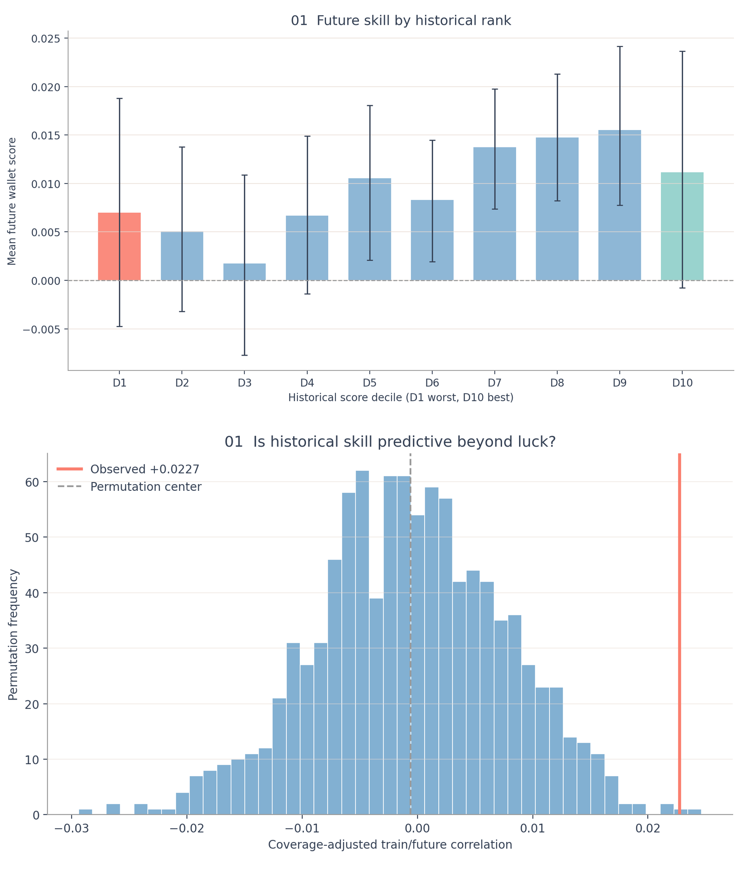
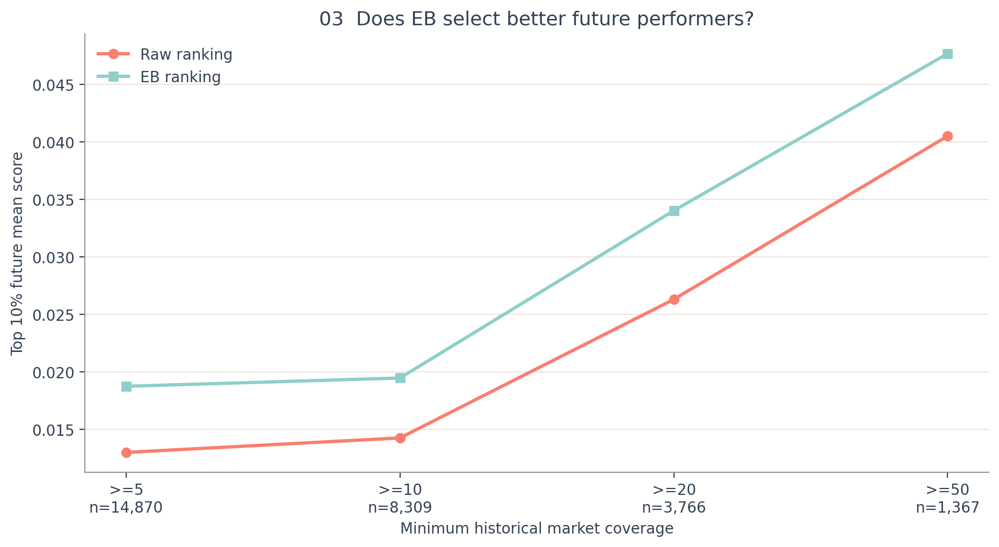
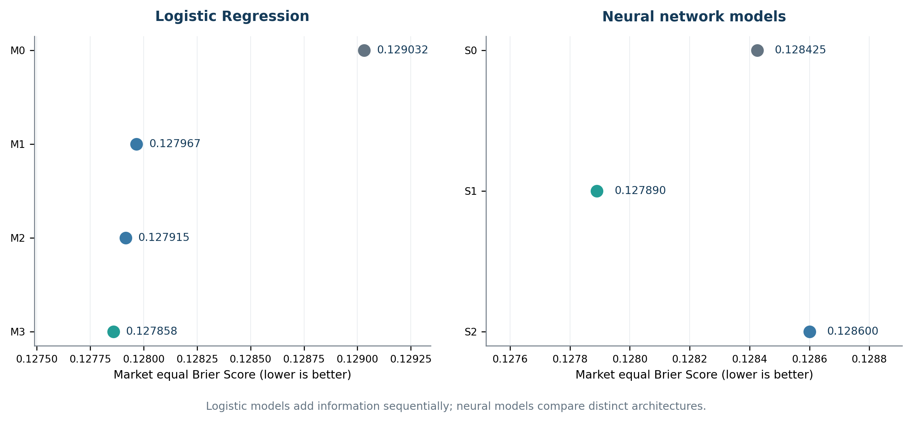
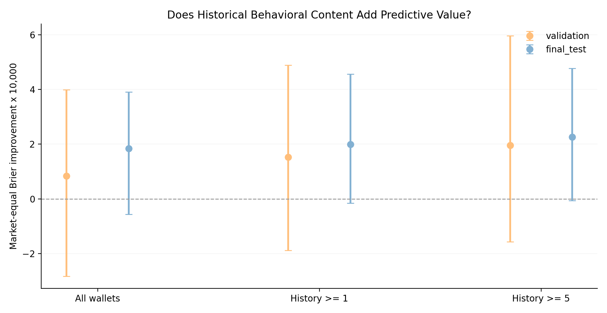
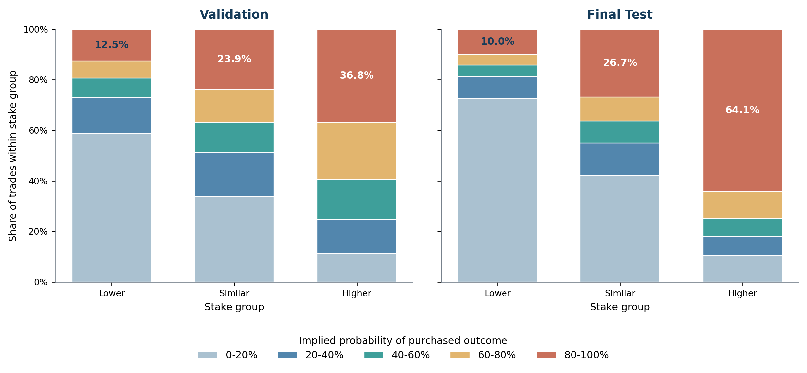
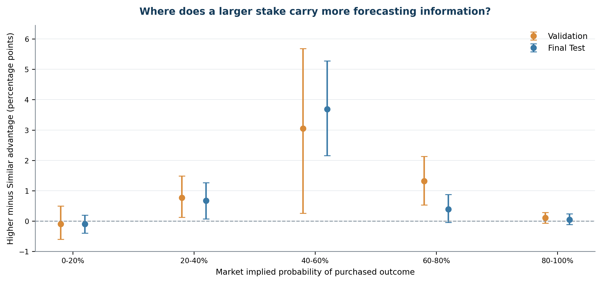

# Gambling Apocalypse Part I: Who Is Actually Smart Money?

Hi, welcome! 👋

I use Polymarket transaction data to investigate whether successful wallets possess persistent forecasting skills and whether their trading behavior contains information beyond market probabilities.

The study explores three questions:

1. **Skill vs. Luck:** Do historical winners consistently outperform the market?
2. **Behavioral Information Alpha:** Can wallet trading behavior improve probability forecasts?
3. **Betting Conviction:** When wallets suddenly bet bigger, do they actually predict better?

**[Read the full research report](reports/Gambling_Apocalypse_Part_I.pdf)**

## At a glance

| | Research scope |
|---|---|
| **Platform** | Polymarket |
| **Period** | January 2025 to March 2026 |
| **Raw data** | 569.5 million historical trades |
| **Coverage** | 1.17 million wallets, 14,925 markets |
| **Predictive modeling** | 4.68 million wallet × market observations |
| **Statistics** | Permutation Tests, Empirical Bayes, Event Cluster Bootstrap |
| **Models** | Logistic Regression, LightGBM, MLP, Mean Pooling, GRU |

## Key findings

- **Forecasting skill persists.** Historical forecasting performance shows statistically significant persistence (**p ≈ 0.007**), with stronger signals among experienced wallets. Empirical Bayes ranking improves the future forecasting performance of the selected top 10% wallets by approximately **44%**.

- **Wallet behavior provides additional predictive signals.** Adding behavioral and historical features reduces forecasting errors beyond calibrated market probabilities. Controlled experiments also suggest that historical trading information has incremental predictive value, although the evidence is not yet conclusive.

- **Bigger bets are most informative in uncertain markets.** Wallets tend to increase their stakes on outcomes already favored by the market. Yet the largest additional forecasting advantage associated with larger bets appears when market probabilities are **40–60%**, reaching **3.05 and 3.69 percentage points** across two evaluation periods.

## 1. Are historical winners actually skilled?

I compare wallets' historical forecasting performance with their future outcomes, using market implied probabilities as the benchmark. The results reveal a statistically significant relationship between past and future performance, with stronger signals among experienced wallets.

I then apply **Empirical Bayes estimation** to account for uncertainty in historical forecasting scores. The method improves the future average score of the selected top 10% wallets from **0.0130 to 0.0188**, an increase of approximately 44%. Interestingly, only about half of the wallets selected by conventional and Empirical Bayes rankings overlap.

These findings highlight how statistical estimation can help identify forecasting skill from noisy historical performance.

## 2. Does wallet behavior add predictive information?

I develop Logistic Regression, LightGBM, and neural network models to examine whether current trading activity and historical wallet behavior improve forecasts beyond market probabilities.

Adding behavioral and historical features reduces the Logistic Regression **Brier Score from 0.127967 to 0.127858** relative to the calibrated market benchmark.

To isolate the contribution of historical trading information, I conduct ablation, shuffle, and controlled model experiments. In the controlled experiment, adding real historical event information reduces the ensemble Brier Score from **0.127466 to 0.127282**. The improvement is positive across three random seeds, although the ensemble Bootstrap confidence interval includes zero.

The results suggest that wallet behavior contains useful predictive signals, while the independent contribution of historical event content remains an interesting direction for further research.

## 3. When wallets bet bigger, do they know better?

The most intriguing finding comes from changes in betting size.

I compare each wallet's current stake with its historical trading behavior to identify unusually large bets. Surprisingly, **64.1% of Higher Stake trades select outcomes with market implied probabilities between 80% and 100%**.

However, larger bets show their greatest additional forecasting advantage in markets where outcomes remain uncertain.

Comparing Higher Stake and Similar Stake observations within common markets and probability intervals, the largest difference occurs when market probabilities are **40–60%**:

- **Validation:** +3.05 percentage points
- **Final Test:** +3.69 percentage points

The difference is close to zero in the 80–100% probability interval.

**Wallets increase their stakes most frequently on outcomes already favored by the market, yet their additional forecasting advantage is most pronounced when market outcomes remain uncertain.**

This exploratory finding suggests that changes in betting behavior, together with market uncertainty, may provide a useful perspective on Smart Money identification.

## Workflow and tools

The project combines on-chain transaction analysis, statistical inference, behavioral feature engineering, predictive modeling, and controlled experiments.

**Methods:** Market adjusted forecasting scores, temporal validation, permutation tests, Empirical Bayes, Bootstrap, model ablation, and historical information controls.

**Tools:** Python, DuckDB, Parquet, pandas, NumPy, scikit-learn, LightGBM, PyTorch, and Matplotlib.

## Repository structure

- [`scripts/`](scripts/) — Data preparation, statistical analysis, forecasting models, and behavioral experiments.
- [`reports/figures/`](reports/figures/) — Selected research figures.
- [`reports/gambling-apocalypse-latex/`](reports/gambling-apocalypse-latex/) — LaTeX research report source.
- [`reports/Gambling_Apocalypse_Part_I.pdf`](reports/Gambling_Apocalypse_Part_I.pdf) — Full research report.
- [`reports/PART_I_A_RESEARCH_CHECKPOINT_2026-11-01.md`](reports/PART_I_A_RESEARCH_CHECKPOINT_2026-11-01.md) — Experiment results and reproducibility checkpoint.

## Data and reproducibility

The study uses Polymarket historical transactions, market metadata, and historical probability data. Predictive features are constructed from information available before each observation, with chronological training and evaluation periods.

Large raw transaction datasets and intermediate Parquet files are stored separately from GitHub. Detailed methods, evaluation results, and research limitations are documented in the full report.

---

Thanks for stopping by! For the complete methodology and additional findings, take a look at the [full research report](reports/Gambling_Apocalypse_Part_I.pdf).